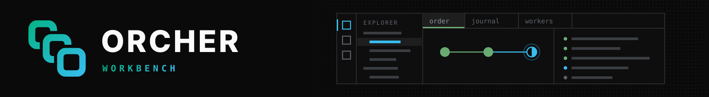

<p>
  <picture>
    <source media="(prefers-color-scheme: dark)" srcset="https://raw.githubusercontent.com/orcher-io/workbench/main/assets/banner.svg">
    <source media="(prefers-color-scheme: light)" srcset="https://raw.githubusercontent.com/orcher-io/workbench/main/assets/banner-light.svg">
    
  </picture>
</p>

<p align="center"><sub>An IDE-style React shell where every feature is a plugin.</sub></p>

<br />

<div>
  <a href="https://www.npmjs.com/package/@orcher/workbench-core"></a>
  <a href="https://github.com/orcher-io/workbench/actions/workflows/ci.yml"></a>
  <a href="./LICENSE"></a>
</div>

<br />

Tabs, splits, sidebars and a command palette, with plugins that declare what they add and load only when needed. It is the shell behind the ORCHER dashboard.

-  **Plugins**: each feature declares its views, commands and keybindings up front
-  **Lazy activation**: a plugin's code runs when its view opens or its command runs
-  **Window manager**: tabs, splits and drag and drop, persisted across reloads
-  **Command palette**: every command a keystroke away
-  **Dependency injection**: services resolved from a small container
-  **Radix Themes**: light and dark, accessible components

<br />

###  Install

```bash
npm install @orcher/workbench-core @orcher/workbench-ui react react-dom
```

Add a built-in plugin the same way, for example `@orcher/workbench-plugin-welcome`.
React 18 or later is a peer dependency.

<br />

###  Quick start

```tsx
import { WorkbenchProvider, Shell } from '@orcher/workbench-core';
import { welcomeDefinition, welcomeModule } from '@orcher/workbench-plugin-welcome';

export function App() {
  return (
    <WorkbenchProvider
      config={{
        theme: { appearance: 'dark' },
        plugins: [{ definition: welcomeDefinition, module: welcomeModule }],
      }}
    >
      <Shell renderEditor={(tab) => <div>{tab.title}</div>} />
    </WorkbenchProvider>
  );
}
```

[`apps/demo`](apps/demo) is a complete Next.js example: `pnpm install && pnpm dev`.

<br />

###  Writing a plugin

A plugin is two parts. The **definition** is data: what the plugin contributes
and which events activate it. The **module** is the code that runs on activation.

```ts
import type {
  PluginDefinition,
  PluginModule,
  ICommandExtensionPoint,
  IViewExtensionPoint,
} from '@orcher/workbench-plugin-api';
import { ServiceTokens } from '@orcher/workbench-plugin-api';

export const notesDefinition: PluginDefinition = {
  id: 'acme-notes',
  version: '0.1.0',
  name: 'Notes',
  activationEvents: ['onView:notes'],
  contributes: {
    viewContainers: { activityBar: [{ id: 'notes', title: 'Notes', icon: 'notes' }] },
    views: { notes: [{ id: 'notes.list', name: 'Notes' }] },
    commands: [{ id: 'notes.create', title: 'New Note', category: 'Notes' }],
    keybindings: [{ command: 'notes.create', key: 'Ctrl+Alt+N', mac: 'Cmd+Alt+N' }],
  },
};

export const notesModule: PluginModule = {
  activate(context) {
    const views = context.container.resolve<IViewExtensionPoint>(ServiceTokens.ViewExtensionPoint);
    const commands = context.container.resolve<ICommandExtensionPoint>(ServiceTokens.CommandExtensionPoint);

    context.subscriptions.push(
      views.registerProvider('notes.list', { component: NotesList }, context.definition.id),
      commands.registerHandler('notes.create', () => createNote(), context.definition.id),
    );
  },
};
```

Contributions are registered up front, so the activity bar, palette and
keybindings know a plugin before its code runs. Activation events decide when it
runs:

| Event | When |
| --- | --- |
| `onStartup` | the workbench starts |
| `onView:<id>` | a view container, or a view inside it, opens |
| `onCommand:<id>` | the command first runs |
| `onEditor:<id>` | a tab with that editor becomes active |
| `*` | at once |

Pass a module through `lazyPlugins` with a loader, instead of `plugins`, to load
its code on activation too. `pnpm g:plugin --name notes` scaffolds a new one.

<br />

###  Window manager

```ts
import { useWindowManager } from '@orcher/workbench-window-manager';

const { openTab, split } = useWindowManager();

openTab({ uri: 'notes://42', title: 'Note 42', editorId: 'notes.editor' }, { preview: true });
split(paneId, 'horizontal');
```

A tab opened for a URI already open activates it. Tabs drag between panes and
to their edges to split them; the layout persists in `localStorage`.

<br />

###  Packages

| Package | What it is |
| --- | --- |
| [`@orcher/workbench-core`](packages/core) | `WorkbenchProvider` and `Shell`: bootstraps services, loads plugins, renders the layout |
| [`@orcher/workbench-plugin-api`](packages/plugin-api) | Plugin definitions, modules, contributions and extension points |
| [`@orcher/workbench-services`](packages/services) | Extension registry, commands, views, keybindings, configuration |
| [`@orcher/workbench-window-manager`](packages/window-manager) | Tabs, splits, drag and drop, layout persistence |
| [`@orcher/workbench-ui`](packages/ui) | Radix Themes components: tree view, command palette, panels, motion |
| [`@orcher/workbench-di`](packages/di) | The dependency-injection container |
| [`@orcher/workbench-plugin-*`](plugins/builtin) | Built-ins: welcome, settings, explorer, search, bookmarks, header, breadcrumb bar |

<br />

###  Development

```bash
pnpm install
pnpm dev          # the demo, at http://localhost:4200
pnpm build && pnpm typecheck && pnpm test:run
```

To release, bump versions in a pull request (`pnpm release --skip-publish`),
merge it, and run the **Publish** workflow. It publishes every package whose
version is not yet on npm through npm trusted publishing. A brand-new package is
published once by hand and then registered as trusting the workflow:
`npx -y npm@^11.15.0 trust github @orcher/workbench-<name> --repo orcher-io/workbench --file publish.yml --allow-publish`.

<br />

###  Contributing

Issues and pull requests are welcome. CI runs a frozen install, `nx sync:check`,
build, typecheck and tests on every pull request; run the same locally before
proposing a change.

###  License

Licensed under the [Apache License, Version 2.0](LICENSE).
